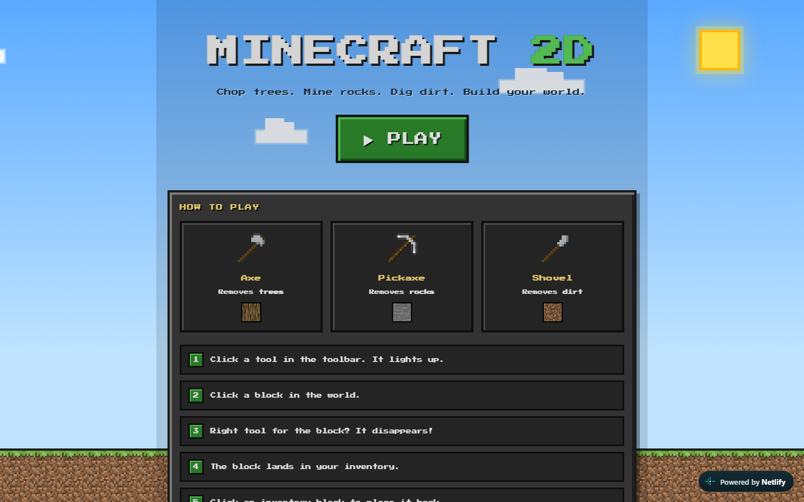
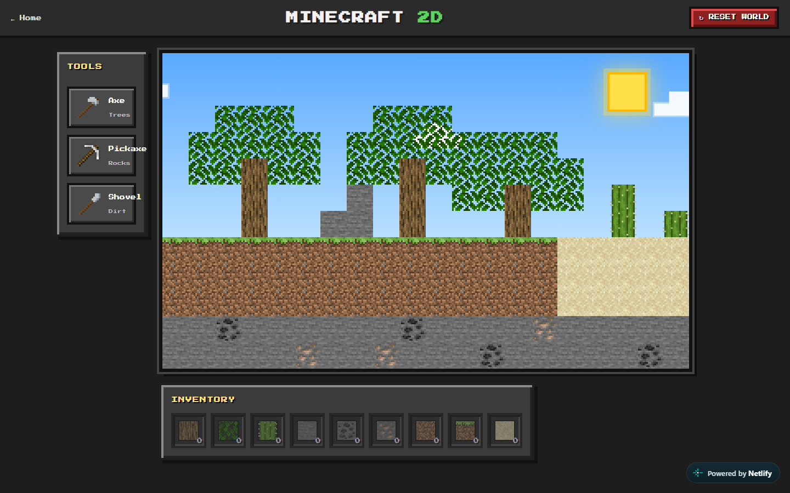
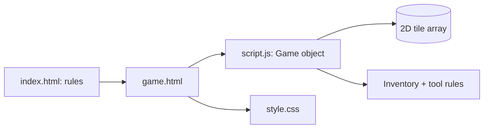

# Minecraft 2D

A 2D Minecraft-style sandbox game built with plain **HTML, CSS and JavaScript** (no libraries or frameworks).

Chop trees, mine rocks, dig dirt, collect the blocks in your inventory and build your world back.


### [▶ Live Demo](https://minecraft-2d-881.netlify.app)

| | |
|---|---|
|  |  |

## How to play

1. Open `index.html` and press **Play**.
2. Pick a tool from the toolbar, then click a tile in the world.
3. If the tool matches the tile, the tile is removed and added to your inventory.
4. Click an item in the inventory, then click an empty (sky) tile to place it.
5. Press **Reset World** to restore the original world and empty the inventory.

| Tool | Removes |
|---|---|
| Axe | tree trunks, leaves, cactus |
| Pickaxe | stone, coal, iron |
| Shovel | dirt, grass, sand |

Using the wrong tool on a tile makes the tile shake instead of removing it.

## Features

- Landing page with the game rules and a short tutorial
- Tile world rendered from a 2D array (trees, leaves, cactus, grass, dirt, sand, stone, coal and iron ores)
- Tool selection with a highlighted active tool
- Tool-to-tile rules: each tool only removes its own tile types
- Inventory with a live counter per block type
- Placing collected blocks back into the world
- Reset button that restores the original world
- Fade animations when tiles are removed or placed
- Responsive layout

## Tech

- HTML5 and CSS (CSS Grid layout, CSS variables, animations)
- Vanilla JavaScript organized as a single `Game` object: world state, rendering, event handling, inventory and tool logic

## Project structure

```
index.html   landing page (rules and tutorial)
game.html    the game (toolbar, world, inventory, reset button)
script.js    game logic
style.css    styles and animations
images/      tile and tool textures
```

## Run locally

No build step. Open `index.html` in a browser, or serve the folder:

```bash
npx serve .
```

## Architecture



## Tests

No automated tests. Checked with Playwright on the live site: both pages load with no console errors or failed requests at 1440 px and 375 px.

## Security notes

Static files only, no network calls and no secrets.

## Roadmap

- Touch controls tuned for phones.
- Save and load the world.
- Crafting.

## Disclaimer

Educational project, not affiliated with Mojang or Microsoft. Minecraft is a trademark of Mojang Synergies AB.

## Author

**Saeed Abuhani**: [github.com/saeedabuhani](https://github.com/saeedabuhani)
